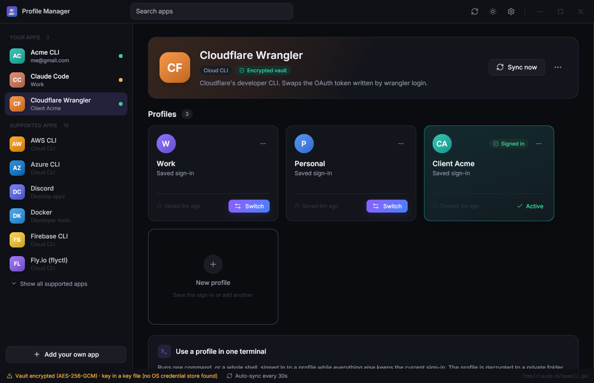

# Profile Manager

Switch the account a program is signed in to without signing out and back in.
Keep a work and a personal Cloudflare login, two Claude Code accounts, separate
AWS or Slack setups. Each is a **profile**, and switching takes one click from the
window or the tray. You can also run a single command signed in to another
profile while the rest of the system stays as it is.



Built with [Giode](https://github.com/xmhrnx/giode) (Go, GPU-rendered, no
webview) for Windows, macOS and Linux, with a custom window frame and a
light and dark theme.

## How it works

Each program keeps its sign-in somewhere on disk or in the OS keychain. An
**app definition** says where. Profile Manager uses one of these strategies,
depending on the definition:

| Strategy | What happens | Used for |
| --- | --- | --- |
| **Swap** | Captures the files, folders, JSON keys and keychain entries that hold the sign-in into an encrypted snapshot, and restores another profile's snapshot in their place. | Wrangler, Claude Code, AWS, Docker, npm, Slack, Discord, Telegram, … |
| **Native** | Calls the program's own profile commands (`gh auth switch`, `gcloud config configurations activate`, `kubectl config use-context`, `az account set`). | Programs that support several accounts themselves. |
| **Per-command** | Decrypts a profile into a private temporary folder, points the program at it with environment variables (`XDG_CONFIG_HOME`, `CLAUDE_CONFIG_DIR`, `KUBECONFIG`, …), saves any changes when the command exits, and wipes the folder. | `profilemanager exec` / `shell`: two accounts in two terminals at once. |

### Keeping profiles up to date

OAuth tokens rotate as programs refresh them, so a saved copy goes stale unless
it's kept in step:

- **Save before switching.** The live sign-in is saved into the active profile
  before another one is restored.
- **Auto-sync.** A background check (every 30 s by default) compares a cheap
  fingerprint of the files (sizes, times, permissions) and only reads them when
  something changed. A change is saved into the active profile.
- **Changes from per-command runs** are saved back too. If that profile is the
  active one, the live copy is updated as well.

### Safety checks

- **Account mismatch.** If the live sign-in now belongs to a different account
  (someone ran `wrangler login` with another account), it is not written over the
  active profile. The app shows the change and lets you keep it as a new profile,
  update the profile, or restore it.
- **Untracked sign-in.** A live sign-in that belongs to no profile is saved as
  one before a switch.
- **Signed out elsewhere.** A sign-out made outside the app is held back, not
  synced into the profile.
- **Running programs.** For programs that hold their files open (Electron apps,
  Claude Code sessions), switching waits until the program is closed, or asks it
  to quit cleanly (SIGTERM, or WM_CLOSE on Windows). Auto-sync pauses while it runs.
- **Atomic writes.** Files are replaced by write-then-rename. Folders are built
  beside the live one and swapped in. If any step fails, the previous sign-in is
  put back, and a rollback copy of it is kept.
- **Symlinks.** Dotfile links such as `~/.npmrc → dotfiles/npmrc` are written
  through, so the links stay intact.
- **Concurrency.** A file lock serializes the window, its background sync and
  command-line runs.

## Security

- Snapshots are sealed with **AES-256-GCM**. Each file's associated data binds
  it to its app and profile, so a file swapped or edited on disk fails
  authentication.
- The random 256-bit master key lives in the **OS credential store**:
  - macOS: Keychain
  - Windows: Credential Manager (DPAPI)
  - Linux: Secret Service (GNOME Keyring, KWallet)

  It is never stored next to the vault.
- Without a credential store (a headless Linux box), the key falls back to a
  private file (`0600`), and the status bar warns about it. The choice is recorded
  at first run, so a keyring that is briefly locked never causes a silent
  fallback.
- If the key is missing but the vault has data, the app refuses to start rather
  than create a new key, which would orphan the saved profiles.
- Other programs' keychain entries are read and written directly: through
  `/usr/bin/security` on macOS (the value goes in as hex on standard input, so
  it never appears in a process list), the Credential Manager API on Windows,
  and the Secret Service D-Bus API on Linux.
- The state file (`state.json`) holds names and hashes only, never secrets.

## Supported apps

Built-in definitions live in `internal/adapter/builtin/*.json`:

| Category | Apps |
| --- | --- |
| Cloud CLIs | Cloudflare Wrangler, AWS CLI, Google Cloud CLI, Azure CLI, Vercel, Netlify, Firebase, Fly.io, Supabase, Terraform/HCP |
| AI tools | Claude Code, OpenAI Codex CLI, Gemini CLI |
| Developer tools | GitHub CLI, kubectl, Docker, npm |
| Desktop apps | Slack, Discord, Telegram Desktop |

### Adding your own

Use **Add your own app** in the window, or import a JSON file. The form covers
the common cases. The JSON tab exposes everything:

```json
{
  "id": "my-tool",
  "name": "My Tool",
  "category": "Internal tools",
  "color": "#14B8A6",
  "files": [
    { "id": "session",
      "paths": { "linux": ["{xdg_config}/my-tool/session.json"],
                 "darwin": ["{home}/Library/Application Support/my-tool/session.json"],
                 "windows": ["{appdata}/my-tool/session.json"] },
      "env_path": "session.json" },
    { "id": "settings", "paths": { "default": ["{home}/.my-tool.json"] },
      "json_keys": ["account", "token"] },
    { "id": "profile", "paths": { "default": ["{home}/.my-tool-data"] },
      "exclude": ["Cache/**", "*.log"] }
  ],
  "keychain": [{ "id": "token", "os": ["darwin"], "service": "my-tool", "account": "{user}" }],
  "env": [{ "name": "MY_TOOL_HOME", "value": "{profile_dir}" }],
  "identity": { "file": "settings", "json": "account.email" },
  "processes": ["my-tool"],
  "close_before_switch": true,
  "native": { "list": ["my-tool", "profiles"], "switch": ["my-tool", "use", "{profile}"] },
  "login_hint": "Run `my-tool login`."
}
```

The fields:

- **Placeholders** usable in paths and values: `~`, `{home}`, `{config}`,
  `{xdg_config}`, `{xdg_data}`, `{appdata}`, `{localappdata}`, `{user}`,
  `{env:NAME}`, and `{profile_dir}` in `env`.
- **`json_keys`** swaps only those keys of a settings file and keeps everything
  else. Claude Code's `~/.claude.json` uses this.
- **`exclude`** keeps caches out of snapshots.
- **`identity`** names the account (an email) on profile cards and enables the
  account-mismatch check.

## Command line

The same binary is a CLI:

```sh
profilemanager list                         # apps with profiles
profilemanager add wrangler Work            # save the current sign-in
profilemanager add wrangler Personal --blank
profilemanager switch wrangler Personal     # --quit closes a running app first
profilemanager exec wrangler Work -- wrangler deploy
profilemanager shell claude-code Work       # a shell signed in to Work
profilemanager sync
profilemanager import my-tool.json
```

## Building

Go 1.26+ is required. On Linux you also need Gio's headers (see the
[Giode getting started guide](https://github.com/xmhrnx/giode)).

```sh
go test ./...
# keychain integration test, against a throwaway GNOME Keyring:
dbus-run-session -- sh -c 'echo pw | gnome-keyring-daemon --unlock --components=secrets >/dev/null &&
    go test -tags keyring_integration ./internal/keyring'
go run .                      # or: giode run
giode build windows-installer dmg deb
```

Releases build in GitHub Actions (`.github/workflows/release.yml`, written by
`giode ci` from `giode.toml`; change `[ci]` there and rerun `giode ci -f`
instead of editing it). Pushing a version tag (`git tag v0.1.0 && git push
--tags`) runs the tests, builds a `.dmg` for macOS, a setup `.exe` and `.msix`
for Windows, and `.deb` and `.rpm` packages for Linux, and attaches them to a
GitHub release. "Run workflow" in the Actions tab builds them without
releasing. Signing uses the repository's secrets when they're set.

The data folder is `ProfileManager` in the user's config folder. Set
`PROFILE_MANAGER_HOME` to use another one.

## Layout

```
main.go, vaultkey.go       wiring: CLI or window, where the vault key lives
internal/adapter           app definitions, placeholders, the editor's form
internal/capture           live sign-in <-> snapshot, fingerprints, identity
internal/vault             AES-256-GCM sealed storage, key sources
internal/keyring           other programs' entries in the Keychain, Credential Manager, Secret Service
internal/engine            profiles, switching, sync, conflicts, per-command runs
internal/native, proc,     native profile commands, process detection,
  lock, fsutil, cli        cross-process lock, atomic writes, command line
ui/                        the window, one component per file
assets/                    app icon (brand/*.svg sources), Inter and JetBrains Mono (OFL),
                           Lucide icons (ISC)
```

## Known limits

- **Keychain access on macOS.** Reading an entry another program created can
  prompt for access the first time.
- **Docker credential helpers.** With `credsStore` set, Docker keeps passwords
  in the helper, keyed by registry. Only plain `auths` entries are switched.
